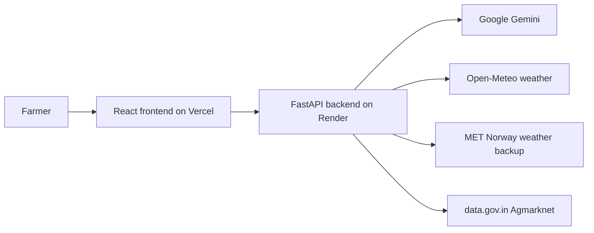

# Kisan Mitra (किसान मित्र)

Local crop advice, weather, mandi prices, and photo-based crop guidance in Marathi, Hindi, and English.

**Live app:** [kisan-mitra-psi-five.vercel.app](https://kisan-mitra-psi-five.vercel.app) · **Hackathon:** IDEA//FORGE, Track 2

## The problem

Small and marginal farmers in Marathwada and Vidarbha often have to check weather, mandi prices, and crop guidance in separate places. Timely information is important when deciding whether to spray, irrigate, harvest, or sell; language and access barriers can make those decisions harder.

## The solution

Kisan Mitra brings local information and guidance into one responsive app:

- **Daily crop advice:** practical suggestions informed by available weather and mandi context, with a rule-based fallback.
- **Voice or text:** ask in Marathi, Hindi, or English, and listen to an answer. Voice input and speech output depend on browser support.
- **Seven-day weather:** forecast details with plain-language risk flags.
- **Mandi comparison:** compare nearby market prices per quintal and see the best listed market.
- **Ask:** get a free-form answer to a farming question, with reasons and steps when available.
- **Crop Doctor:** upload or take a leaf photo for a possible diagnosis using Gemini image analysis.
- **Responsible use:** AI can be wrong. Crop Doctor is not a confirmed diagnosis. Ask a local agriculture officer or Krishi Vigyan Kendra about treatment decisions and pesticide dosages.

## How AI is used

Gemini generates daily advice and answers farmer questions using the weather and mandi context supplied by the backend. Crop Doctor sends an uploaded crop image to Gemini Vision for observations and a possible diagnosis. Prompts instruct the model to use only supplied information, avoid invented numbers and chemical dosages, and refer farmers to a local agriculture officer for treatment guidance. AI responses can still be incomplete or incorrect; verify important decisions locally.

## Architecture and fallbacks



Weather tries Open-Meteo first, then MET Norway, then a successful in-memory district cache, and finally a bundled district sample forecast. Weather responses identify their source. Mandi uses data.gov.in when available and can return labeled sample data if live prices are unavailable. Backend in-memory caches are cleared when the service restarts.

## Tech stack and free tools

- **Frontend:** React, Vite, Tailwind CSS, Lucide icons, and Noto Sans Devanagari.
- **Backend:** Python, FastAPI, and Uvicorn.
- **AI:** Google Gemini through the Google Gen AI SDK; availability and quotas depend on the provider's current plan.
- **Weather:** Open-Meteo and MET Norway locationforecast; no provider key is used for these requests.
- **Market data:** data.gov.in Agmarknet API; live access depends on its API availability and quota.
- **Speech:** browser Web Speech API.
- **Hosting and uptime:** Vercel, Render, and optional UptimeRobot health checks. Free-tier limits and availability are controlled by each provider.

## API routes

| Method | Route | Purpose |
| --- | --- | --- |
| `GET` | `/health` | Health check |
| `GET` | `/api/districts` | Supported district list |
| `GET` | `/api/weather?district=beed` | Current conditions, seven-day forecast, and risk flags |
| `GET` | `/api/mandi?district=beed&crop=Soybean` | Market prices and best listed market |
| `POST` | `/api/advice` | Daily crop advice |
| `POST` | `/api/ask` | Answer a farmer's question |
| `POST` | `/api/diagnose` | Crop Doctor image diagnosis; accepts an image and crop, district, and language form fields |
| `GET` | `/api/debug/weather?district=beed` | Weather provider status and non-secret error summaries |
| `GET` | `/api/debug/gemini` | Gemini text and image probes with non-secret status/error information |

## Run locally

Run the backend and frontend in separate terminals from the repository root. Copy the example environment files and put any provider credentials only in the corresponding local `.env` file. Never commit `.env` files.

### Windows PowerShell

Backend terminal:

```powershell
cd backend
Copy-Item .env.example .env
py -3.11 -m venv .venv
.\.venv\Scripts\Activate.ps1
python -m pip install --upgrade pip
pip install -r requirements.txt
notepad .env
uvicorn main:app --reload
```

Frontend terminal:

```powershell
cd frontend
Copy-Item .env.example .env
npm install
npm run dev
```

Open the local URL Vite prints (normally `http://localhost:5173`). The frontend `.env` should set `VITE_API_URL=http://localhost:8000`. In `backend/.env`, add `GEMINI_API_KEY` for Gemini features; `DATA_GOV_API_KEY` is optional and used for live mandi access. Keep `ALLOWED_ORIGIN=http://localhost:5173` for local development. Check the backend at `http://localhost:8000/health`.

### macOS or Linux

Use separate terminals. From the repository root, run `cd backend`, create and activate a Python virtual environment (`python3 -m venv .venv` and `source .venv/bin/activate`), install `requirements.txt`, copy `.env.example` to `.env`, then run `uvicorn main:app --reload`. In another terminal run `cd frontend`, copy `.env.example` to `.env`, run `npm install` and `npm run dev`. Set the same environment values described above.

## Deploy

### Render backend

Create a Render web service from this repository with **Root Directory** `backend`, **Build Command** `pip install -r requirements.txt`, and **Start Command** `uvicorn main:app --host 0.0.0.0 --port $PORT`. Add `GEMINI_API_KEY` and the configured `GEMINI_MODEL`; add `DATA_GOV_API_KEY` if using authenticated live market data. Set `ALLOWED_ORIGIN` to the exact deployed Vercel origin, for example `https://your-project.vercel.app` (no trailing path). Confirm the service responds at `/health`.

### Vercel frontend

Import this repository into Vercel and set the project **Root Directory** to `frontend`. Add `VITE_API_URL` with the full Render backend URL, such as `https://your-service.onrender.com`, then deploy. If the Vercel domain changes, update Render's `ALLOWED_ORIGIN` to match it and redeploy/restart the backend as required.

## Limitations

- Render free-tier services can cold-start after inactivity; response time depends on hosting availability.
- Mandi results depend on data.gov.in/Agmarknet availability, coverage, and quota. Sample prices may be returned when live data is unavailable and should be treated as samples.
- Crop Doctor gives a possible image-based diagnosis, not a certain or expert diagnosis. Confirm problems and treatments with a local agriculture officer or Krishi Vigyan Kendra.
- AI-generated guidance may be wrong or incomplete. Never infer pesticide dosage from the app; check with an agriculture officer.
- Speech support varies by browser and device. The app has no offline mode, and backend caches are in memory rather than persistent storage.

## Future scope

- Opt-in WhatsApp alerts.
- Verified coverage for more states and crops.
- Offline support for saved information and guidance.

## Screenshots

Add screenshots to `docs/screenshots/` and replace these placeholders when the image files are available:

| Screen | Image |
| --- | --- |
| Home | `docs/screenshots/home.png` (placeholder) |
| Ask | `docs/screenshots/ask.png` (placeholder) |
| Mandi | `docs/screenshots/mandi.png` (placeholder) |
| Weather | `docs/screenshots/weather.png` (placeholder) |
| Crop Doctor | `docs/screenshots/crop-doctor.png` (placeholder) |

## Credits

Google Gemini · Open-Meteo · MET Norway · data.gov.in (Agmarknet) · Vercel · Render · UptimeRobot · Web Speech API · React · Vite · Tailwind CSS · FastAPI · Google Stitch (UI design) · OpenAI Codex and Claude (AI coding assistants).
